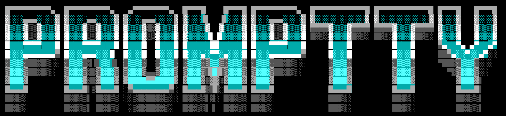

  

  A native macOS terminal for working alongside coding agents. 
  Built on <a href="https://ghostty.org">libghostty</a>, the engine behind Ghostty.

## What you get

- **A calm, native window.** A sidebar (or tab strip) with each pane in its own rounded card.
  The [Flexoki](https://github.com/kepano/flexoki) theme follows your system's light and dark
  mode, and every Ghostty theme is one click away.
- **Agents at a glance.** PrompTTY spots Claude Code, Codex, Amp, Cline and others running in
  a pane. Each tab shows whether its agent is working, waiting for permission or done, and you
  get a notification when it needs you.
- **Long commands tell you when they're done.** A command that ran 10 seconds or more in a tab you
  aren't looking at posts a notification with how it ended and how long it took (Settings › Tabs
  sets how long is long, or turns it off).
- **A smarter prompt.** In zsh, an input bar replaces the shell prompt: history, suggestions,
  Tab completion, syntax coloring, vi mode and fuzzy history search (⌃R).
- **Command blocks.** Every command and its output is a block you can jump between, copy, copy
  as Markdown or rerun. ⌃⌘↑ jumps straight to the last failure. ⌘F finds anything in the
  scrollback, every match highlighted.
- **Pick up where you left off.** Quit and reopen PrompTTY: every tab comes back in its folder
  with what it printed before, colors included, above a fresh prompt (zsh).
- **Projects and pinned tabs.** Group tabs into projects. Pin a tab running `claude` or
  `npm run dev` and it comes back, still running, the next time you open PrompTTY.
- **Command palette.** ⇧⌘P finds any tab in any window and runs any command by name, with its
  shortcut beside it.
- **Splits.** Split right or down, drag to resize, zoom one pane to fill the tab.
- **Undo a closed tab.** ⇧⌘T brings back the last ten closed tabs, splits and folders included.
- **Safe by default.** ⌘-click opens links and `path:line:col`, but never runs programs.
  Programs must ask before using your clipboard, and password prompts get secure input.

## Install

Download the latest `.dmg` from [Releases](https://github.com/ExManubis/promptty/releases) and
drag PrompTTY to Applications. Requires an Apple silicon Mac with macOS 26.

## Connect your agents

PrompTTY can guess an agent's state from its screen, but it knows for sure with hooks:

- **Claude Code:** open **Settings › Agents › Install Claude Code Hooks…**. You see what will
  change before anything is written, and **Remove…** undoes it. Start a new Claude Code session
  afterwards.
- **Codex:** add the line shown in **Settings › Agents** to the top of `~/.codex/config.toml`.

The hooks send PrompTTY only what it needs to show state (never your prompts or tool input).
If you move PrompTTY.app, install the hooks again.

## Keys

PrompTTY only takes shortcuts with ⌘, so ⌃ and ⌥ combinations reach your programs (Neovim
included), and Option works as Alt. Every shortcut can be changed in **Settings › Keyboard**.

| Action | Keys |
|---|---|
| Command palette | ⇧⌘P |
| New window / close window | ⌘N / ⇧⌘W |
| New tab / close tab | ⌘T / ⌥⌘W |
| Reopen the last closed tab | ⇧⌘T |
| Next / previous tab, go to tab 1–9 | ⇧⌘] / ⇧⌘[, ⌘1…⌘9 |
| Toggle sidebar / sidebar or strip | ⌘B / ⌃⌘S |
| Split right / split down | ⌘D / ⇧⌘D |
| Close pane | ⌘W |
| Move focus between panes | ⌥⌘← ↑ → ↓ (or ⌥H J K L) |
| Equalize / zoom panes | ⌃⌘= / ⇧⌘↩ |
| Select previous / next command | ⌘↑ / ⌘↓ |
| Select previous / next failed command | ⌃⌘↑ / ⌃⌘↓ |
| Copy the command's output / the command | ⌥⌘C / ⇧⌘C |
| Rerun the selected command | ⇧⌘R |
| Find in the scrollback / next / previous | ⌘F / ⌘G / ⇧⌘G |
| Find the selected text | ⌘E |
| Search history | ⌃R |

## Settings

Everything lives in **PrompTTY › Settings…** (⌘,) and applies immediately: fonts, themes,
cursor, sidebar or tab strip, session restore, clipboard access, shortcuts and agent hooks.
PrompTTY keeps its own settings and does not read your Ghostty config.

## Contributing

Build instructions, the source layout and how the agent hooks work are in
[docs/DEVELOPMENT.md](docs/DEVELOPMENT.md). Third-party logos are credited in
[CREDITS.md](CREDITS.md).
